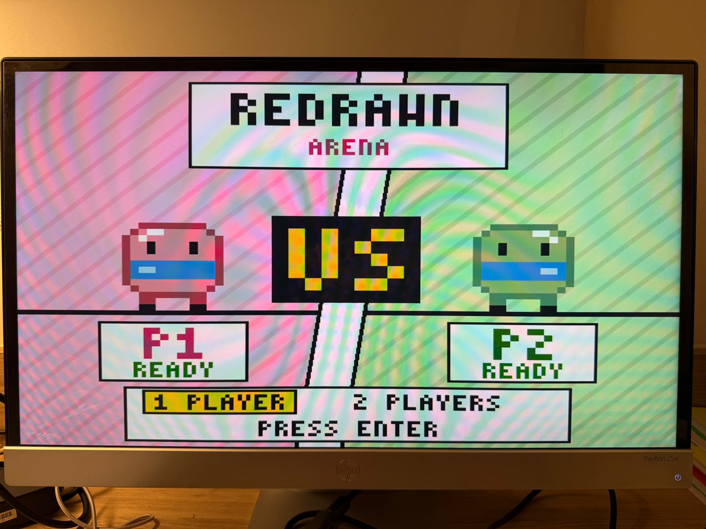
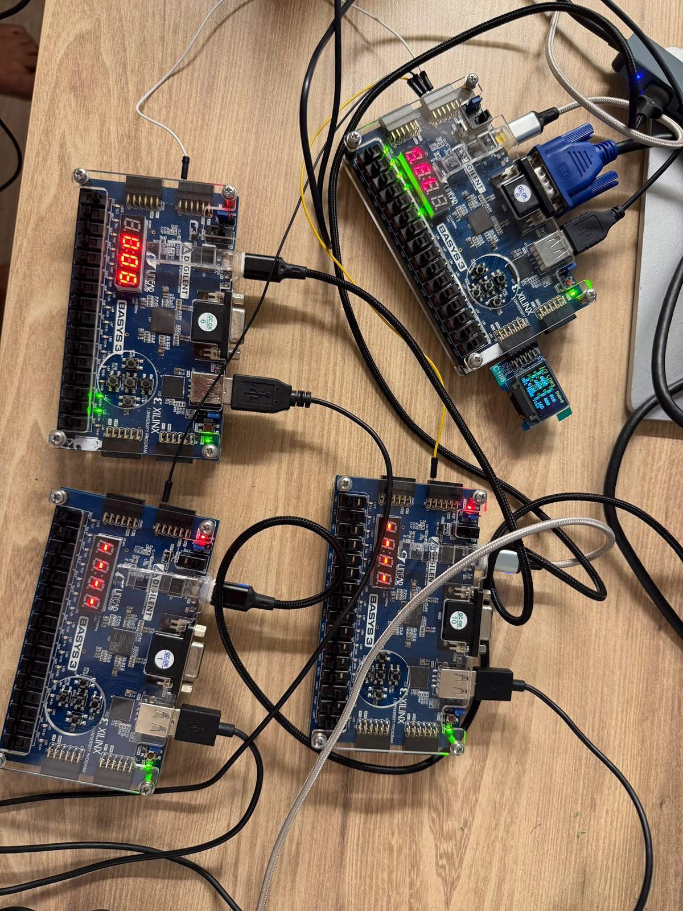

# ReDrawn & Arena

A pixel-art shooter platformer written in Verilog for the Digilent Basys 3 FPGA board. Built by a team of four for EE2026 Digital Design at the National University of Singapore (AY2026/27 Semester 1).

**Demo video:** https://canva.link/yy1q9o5akjqfghh

## What it does

- **ReDrawn (single player):** a puzzle platformer with seven levels, drawn at 640x480 over VGA.
- **Level editor:** build and play your own levels on the board.
- **Arena (two players):** a head-to-head shooter with map select, countdown, pause, match timer, health and rematch.
- **Linked boards:** extra Basys 3 boards act as keyboard and mouse senders for the second player, connected to the main board over UART.

## Hardware

- Digilent Basys 3 (Xilinx Artix-7, `xc7a35tcpg236-1`)
- VGA monitor
- USB keyboard and USB mouse (through the board's PS/2 emulation)
- Pmod OLED on the main board (debug display)
- For Arena: one or more extra Basys 3 boards, wired to the main board's JA header

## One bitstream, three roles

Every board runs the same bitstream. Switches 15 and 14 choose what the board does.

| SW15 | SW14 | Role |
|---|---|---|
| 0 | 0 | Main board (runs the game and drives VGA) |
| 0 | 1 | Keyboard sender |
| 1 | 0 | Mouse sender (SW2 swaps the buttons for left-handed use) |
| 1 | 1 | Main board |

The logic for the unused roles is held in reset, so a sender board transmits nothing but its own packets.

## Board-to-board link

- UART at 115200 baud, one wire per sender into the main board's JA header.
- The receiver passes the line through a two-flip-flop synchroniser, samples in the middle of each bit and rejects start-bit glitches.
- Senders transmit a packet every 10 ms with a header byte and a check byte. The receiver drops any packet that fails the check.
- If no valid packet arrives for 50 ms, held keys are released, so unplugging a cable cannot leave a player stuck moving.

## Source layout

| Path | Contents |
|---|---|
| `src/game_top.v` | Top level: reset and switch synchronisers, VGA, role select, module wiring |
| `src/redrawn_core.v`, `src/editor.v`, `src/editor_ui.v` | Single-player game and level editor |
| `src/arena_core.v`, `src/arena_render.v`, `src/match_fsm.v` | Two-player arena and its match state machine |
| `src/menu_screen.v` | Menu and mode select |
| `src/uart_rx.v`, `src/uart_tx.v` | UART receiver and transmitter |
| `src/link_*.v`, `src/packet*_*.v`, `src/sender_roles.v` | Packet framing, checking and sender roles |
| `src/phys_*.v`, `src/level_collision*.v` | Player and box physics, collision |
| `src/bullets.v`, `src/gun.v`, `src/aim*.v`, `src/pickups.v`, `src/player_stats.v`, `src/spawn_picker.v`, `src/lfsr16.v` | Arena gameplay |
| `src/vga_sync.v`, `src/pixel_gen.v`, `src/tilemap.v`, `src/sprite*.v`, `src/text_cell.v` | Video timing and rendering |
| `src/*.mem`, `src/*.vh` | Level, sprite, font and lookup-table data |
| `constraints/game_basys3.xdc` | Pin constraints for the Basys 3 |
| `bitstream/game_top.bit` | Prebuilt bitstream |

## Build

1. Open Vivado and create an RTL project for part `xc7a35tcpg236-1`.
2. Add everything in `src/` as design sources, and `constraints/game_basys3.xdc` as a constraint file.
3. Set `game_top` as the top module.
4. Run synthesis, implementation and Generate Bitstream.

To skip the build, program the board with `bitstream/game_top.bit` from the Vivado Hardware Manager.

## Third-party code

- `src/Ps2Interface.vhd` and `src/Mouse_Control.vhd`: PS/2 and mouse controller by Ulrich Zoltán, copyright 2006 Digilent, Inc.
- `src/Oled_Display.v`: OLED driver, copyright 2017 Joel Holdsworth, BSD 3-clause licence (see the file header).

All other modules were written by the project team.
